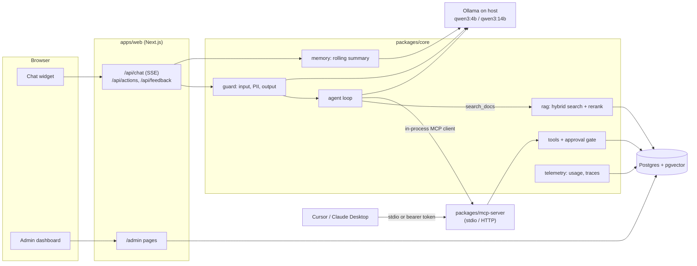
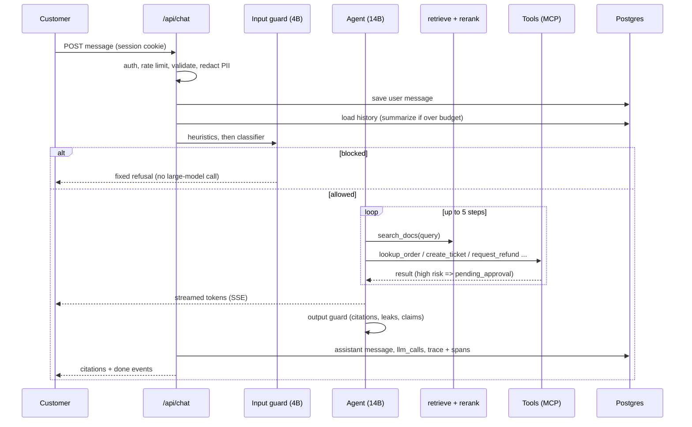

# Architecture

## Components



| Package               | Responsibility                                                                                    |
| --------------------- | ------------------------------------------------------------------------------------------------- |
| `apps/web`            | Widget, admin pages, API routes, Auth.js sessions, rate limiting at the edge of each route        |
| `packages/core`       | Agent loop, retrieval, prompts, guardrails, memory, tools and approvals, telemetry, admin queries |
| `packages/db`         | Drizzle schema, migrations, deterministic seed                                                    |
| `packages/mcp-server` | The tool registry over MCP (stdio for local clients, Streamable HTTP with identity tokens)        |
| `evals`               | Golden set, scorers, LLM judge calibration, result reports                                        |
| `knowledge-base`      | 32 Ledgerly help-center pages (markdown with frontmatter), including deliberate traps             |

## One chat turn



Every model call goes through a metering middleware, so the guard, router, summarizer, and agent calls all land in
`llm_calls` with tokens, latency, and projected cost. Spans for history, guard, route, retrieve, rerank, each model call,
and each tool call are stored per request in `traces` / `spans` (and optionally exported to Langfuse).

## Data model

| Table                                     | Purpose                                                                  |
| ----------------------------------------- | ------------------------------------------------------------------------ |
| `documents`, `chunks`                     | Knowledge base; `chunks.embedding vector(384)` (HNSW) and `tsv` (GIN)    |
| `customers`, `orders`, `tickets`          | Seeded product data the tools act on                                     |
| `users`, `rate_limits`                    | Demo accounts (scrypt hashes) and token buckets                          |
| `conversations`, `messages`               | Chat history, rolling summary, per-message metadata (route, guard flags) |
| `pending_actions`, `refunds`, `audit_log` | Human-in-the-loop approvals and their audit trail                        |
| `llm_calls`, `traces`, `spans`            | Cost and latency telemetry                                               |
| `message_feedback`                        | Thumbs up / down from the widget                                         |

## Runtime (Docker)

```mermaid
flowchart LR
  db[(db: pgvector)] --> setup[setup: migrate, seed once, ingest]
  setup --> web[web :3000]
  setup --> mcp[mcp 127.0.0.1:3333]
  web -. host.docker.internal:11434 .-> ollama[Ollama on host]
  web --- models[(models volume)]
  setup --- models
```

Details and trade-offs: [ADR 009](adr/009-docker-packaging.md). All decisions: [`docs/adr/`](adr/).
